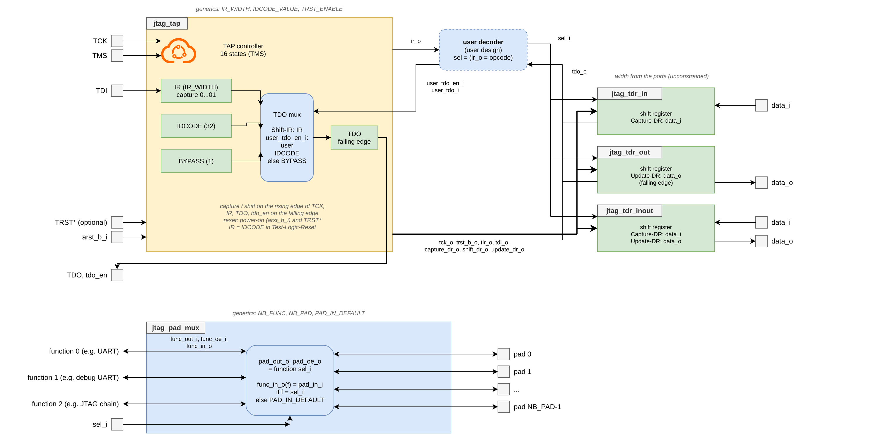
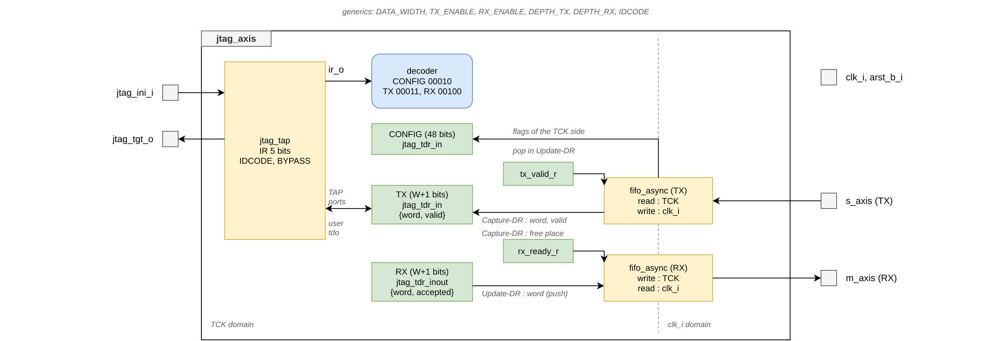
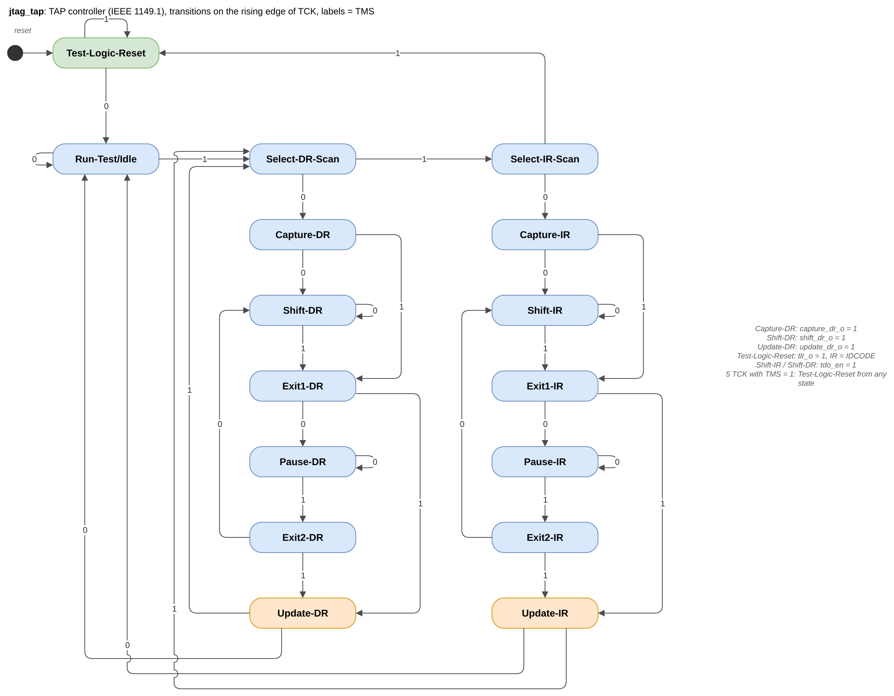
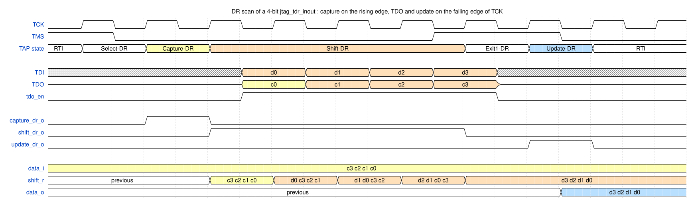

<!--
  README MODEL (common to every Asylum IP, keep the same headings)
  ----------------------------------------------------------------
  Regenerate from the sources, never from the previous README text alone:
    hdl/*.vhd (entities, generics, ports), hdl/csr/*.hjson (register map),
    <IP>.core (VLNV, targets, depends), mk/targets.txt, sim/, syn/, esw/.
  Sections, in this order:
    badges / title + one-line pitch / Overview / Features / Block Diagram /
    Getting Started / Hardware Interfaces / Configuration / Resources /
    Theory of Operation / Registers / Programmer's Guide /
    Design Verification / Dependencies and Related IPs / License
  Rules:
    - English, short and factual: every statement backed by the sources.
    - No VLNV line: the version badge shows it.
    - Badges: first line version, license; second line CI, lint, sim, syn.
    - Block diagram and FSM: pages Overview and FSM of doc/<NAME>.drawio, exported to
      doc/<NAME>-Overview.png and doc/<NAME>-FSM.png (make -C doc).
    - Timing diagrams: WaveDrom source doc/<NAME>-<what>.json, rendered
      doc/<NAME>-<what>.svg (make -C doc), shown as images.
    - No CPU named (OpenBlaze, PicoBlaze, RISC-V) outside the CPU and SoC IPs.
    - Registers: link to the generated hdl/csr/<X>_csr.md, never copy the tables.
    - Tables: Configuration = Name|Type|Default|Description,
      Hardware Interfaces = Name|Direction|Type|Description, grouped by interface.
    - A section with nothing to say is one line ("This IP has no
      software-visible registers."), never removed.
-->
[](https://github.com/deuskane/asylum-debug-jtag/tags)
[](LICENSE)

[](https://github.com/deuskane/asylum-debug-jtag/actions/workflows/ci.yml)
[](https://github.com/deuskane/asylum-debug-jtag/actions/workflows/ci.yml)
[](https://github.com/deuskane/asylum-debug-jtag/actions/workflows/ci.yml)
[](https://github.com/deuskane/asylum-debug-jtag/actions/workflows/ci.yml)

# JTAG TAP, Test Data Registers, Pad Multiplexer, JTAG over a UART and AXI-Stream Bridge

**A small, readable IEEE 1149.1 JTAG Test Access Port in VHDL: the 16-state TAP controller, IDCODE and BYPASS, user instructions decoded outside the TAP, test data registers of any width, a generic pad multiplexer to share a few pads between functions, a JTAG master driven by the OpenOCD `remote_bitbang` protocol, so that any USB-UART cable becomes a JTAG probe, and an AXI-Stream bridge between the system and the debugger.**

Part of the [Asylum project](https://github.com/deuskane/asylum-project), a collection of small IP cores, written to be read and learned from.

## Table of Contents

1. [Overview](#overview)
2. [Features](#features)
3. [Block Diagram](#block-diagram)
4. [Getting Started](#getting-started)
5. [Hardware Interfaces](#hardware-interfaces)
6. [Configuration](#configuration)
7. [Resources](#resources)
8. [Theory of Operation](#theory-of-operation)
9. [Registers](#registers)
10. [Programmer's Guide](#programmers-guide)
11. [Design Verification](#design-verification)
12. [Dependencies and Related IPs](#dependencies-and-related-ips)
13. [Repository Layout](#repository-layout)
14. [License](#license)

## Overview

JTAG (IEEE 1149.1) gives a debugger access to the inside of a chip through four pins: TCK (clock), TMS (mode select), TDI (data in) and TDO (data out), plus an optional TRST\* (reset). The pins drive a Test Access Port (TAP): a 16-state controller walked by TMS, an instruction register (IR) and data registers (DR) shifted between TDI and TDO.

This IP gives the building blocks to put your own registers behind a JTAG port:

- `jtag_tap` ([hdl/jtag_tap.vhd](hdl/jtag_tap.vhd)): the TAP controller, the IR (`IR_WIDTH` bits), the IDCODE and BYPASS registers and TDO. Your design decodes the user instructions from `ir_o` and gives the TDO of the selected user register (`user_tdo_en_i`, `user_tdo_i`).
- Three test data registers (TDRs), whose width is the width of their data ports: `jtag_tdr_in` ([hdl/jtag_tdr_in.vhd](hdl/jtag_tdr_in.vhd), parallel input: reads a value), `jtag_tdr_out` ([hdl/jtag_tdr_out.vhd](hdl/jtag_tdr_out.vhd), parallel output: writes a value) and `jtag_tdr_inout` ([hdl/jtag_tdr_inout.vhd](hdl/jtag_tdr_inout.vhd), both).
- `jtag_pad_mux` ([hdl/jtag_pad_mux.vhd](hdl/jtag_pad_mux.vhd)): a generic multiplexer that lets several functions share a group of pads, for example a UART, a debug UART and a JTAG chain on the four pads of a UART.
- `jtag_bitbang` ([hdl/jtag_bitbang.vhd](hdl/jtag_bitbang.vhd)): a JTAG master driven by a byte stream, the ASCII protocol of the OpenOCD `remote_bitbang` adapter (one byte per pin change or TDO read). Behind a UART, a plain USB-UART cable and `socat` turn OpenOCD into the debugger of the TAPs of the design: no JTAG probe, no extra pin (see [JTAG over a UART](#jtag-over-a-uart)).

- `jtag_axis` ([hdl/jtag_axis.vhd](hdl/jtag_axis.vhd)): an AXI-Stream bridge with its own TAP: the system writes words on `s_axis` that the debugger reads with the instruction TX, the debugger writes words with the instruction RX that the system reads on `m_axis` (each direction optional, one dual-clock FIFO each, any TCK).

There is no boundary scan: the TAP is a debug and test port for the logic inside the FPGA. The TAP and the TDRs run in the TCK clock domain and need no system clock; `jtag_bitbang` runs in the system clock domain and produces TCK.

## Features

- IEEE 1149.1 TAP controller: 16 states, transitions on the rising edge of TCK, Test-Logic-Reset after 5 TCK with TMS = 1 from any state
- Power-on reset (`arst_b_i`) and optional TRST\* (`TRST_ENABLE`), both asynchronous
- Instruction register of `IR_WIDTH` bits (at least 2): Capture-IR loads `0...01`, IDCODE (`0...01`) selected after reset and in Test-Logic-Reset
- IDCODE (32 bits, `IDCODE_VALUE`, bit 0 = 1 checked at elaboration) and BYPASS (all ones, and every opcode not claimed by the user decoder)
- User instructions decoded outside the TAP from `ir_o`: `user_tdo_en_i = 1` selects `user_tdo_i` as TDO
- Capture and shift on the rising edge of TCK, IR, TDO and update on the falling edge, `tdo_en` high in Shift-IR / Shift-DR only (tri-state TDO at the pad)
- Three TDR entities with unconstrained data ports (any width and range); `data_o` held between two Update-DR, cleared by the TAP reset and in Test-Logic-Reset
- Generic pad multiplexer: `NB_FUNC` functions on `NB_PAD` pads, the unselected functions see `PAD_IN_DEFAULT`
- `jtag_bitbang`: OpenOCD `remote_bitbang` commands on an 8-bit AXI-Stream input (write TCK / TMS / TDI, read TDO, TRST\* and SRST, LED), answers to the TDO reads on an AXI-Stream output, the other bytes ignored; no UART inside, about 16 LUTs and 7 flip-flops
- `jtag_axis`: its own TAP (5-bit IR, `IDCODE` generic), instructions CONFIG (enables, `DATA_WIDTH`, empty and full flags), TX (read a word: `{word, valid}`) and RX (write a word: accepted bit), AXI-Stream `s_axis` (TX) and `m_axis` (RX) on `clk_i`, `TX_ENABLE` / `RX_ENABLE`, one `fifo_async` per direction (`DEPTH_TX`, `DEPTH_RX`): TCK may be any clock, unrelated to `clk_i`; OpenOCD procedures `jtag_axis_config`, `jtag_axis_pop`, `jtag_axis_push` ([tools/openocd/jtag_axis.tcl](tools/openocd/jtag_axis.tcl))
- Equivalent to the TAP of the WardRV debug unit (`WardRV_dbg_tap`) with the decoder `user_tdo_en = (ir = DTMCS or ir = DMI)`

## Block Diagram



- `jtag_tap`: the TAP controller follows TMS; the IR, IDCODE and BYPASS registers capture and shift; the TDO multiplexer selects the IR in Shift-IR, else the user register when `user_tdo_en_i = 1`, else IDCODE or BYPASS; TDO is registered on the falling edge of TCK.
- The user decoder belongs to your design: it compares `ir_o` with the opcodes of its registers, drives the `sel_i` of each TDR, `user_tdo_en_i` and `user_tdo_i` (the `tdo_o` of the selected TDR).
- The TDRs receive the control outputs of the TAP (`tck_o`, `trst_b_o`, `tlr_o`, `capture_dr_o`, `shift_dr_o`, `update_dr_o`, `tdi_o`).
- `jtag_pad_mux` is independent of the TAP: it connects one of `NB_FUNC` functions to the pads.
- `jtag_axis` (below): `jtag_tap`, its decoder, three TDRs and two `fifo_async`; the Gray pointers of the FIFOs are the only signals between the TCK domain and `clk_i`.
- `jtag_bitbang` decodes one command byte per handshake of `s_axis` into its registers (TCK, TMS, TDI; TRST\*, SRST, LED) and answers each `'R'` with TDO on `m_axis`. Its `jtag_ini_o` drives the `jtag_ini_i` of the TAPs (or the first TAP of a chain), their `jtag_tgt_o` comes back on `jtag_tgt_i`. The UART is not part of it: `uart_rx_axis` / `uart_tx_axis` of [asylum-communication-uart](https://github.com/deuskane/asylum-communication-uart), or any other byte stream.



## Getting Started

The cores of the Asylum IPs are published in the FuseSoC library [asylum-cores](https://github.com/deuskane/asylum-cores) (with the UVVM cores used by the testbenches):

```bash
pip install fusesoc
fusesoc library add https://github.com/deuskane/asylum-cores
fusesoc run --target sim_jtag_tdr_inout asylum:debug:jtag  # needs GHDL
```

To use the IP in your design, add `asylum:debug:jtag` to the `depend` list of your core; the entities and their components (`asylum.jtag_pkg`) are in library `asylum`.

### A TAP with two user registers

A 5-bit IR, a 16-bit status register read through JTAG (opcode 2) and an 8-bit control register written and read back (opcode 4), built as [syn/jtag_wrapper.vhd](syn/jtag_wrapper.vhd):

```vhdl
library asylum;
use     asylum.jtag_pkg.all;

  -- User opcodes
  constant IR_STATUS  : std_logic_vector(5-1 downto 0) := "00010";
  constant IR_CONTROL : std_logic_vector(5-1 downto 0) := "00100";

  ins_tap : jtag_tap
    generic map
    (IR_WIDTH        => 5
    ,IDCODE_VALUE    => x"10000001"
    ,TRST_ENABLE     => true
    )
    port map
    (arst_b_i        => arst_b             -- power-on reset
    ,jtag_ini_i      => jtag_ini           -- tck, trst_n, tms, tdi
    ,jtag_tgt_o      => jtag_tgt           -- tdo, tdo_en
    ,tck_o           => tck
    ,trst_b_o        => trst_b
    ,tlr_o           => tlr
    ,ir_o            => ir
    ,capture_dr_o    => capture_dr
    ,shift_dr_o      => shift_dr
    ,update_dr_o     => update_dr
    ,tdi_o           => tdi
    ,user_tdo_en_i   => user_tdo_en
    ,user_tdo_i      => user_tdo
    );

  -- User decoder
  sel_status  <= '1' when ir = IR_STATUS  else '0';
  sel_control <= '1' when ir = IR_CONTROL else '0';
  user_tdo_en <= sel_status or sel_control;
  user_tdo    <= tdo_status when sel_status = '1' else
                 tdo_control;

  ins_status : jtag_tdr_in
    port map
    (tck_i           => tck
    ,trst_b_i        => trst_b
    ,sel_i           => sel_status
    ,capture_dr_i    => capture_dr
    ,shift_dr_i      => shift_dr
    ,update_dr_i     => update_dr
    ,tdi_i           => tdi
    ,tdo_o           => tdo_status
    ,data_i          => status             -- std_logic_vector(16-1 downto 0) : 16-bit register
    );

  ins_control : jtag_tdr_inout
    port map
    (tck_i           => tck
    ,trst_b_i        => trst_b
    ,tlr_i           => tlr
    ,sel_i           => sel_control
    ,capture_dr_i    => capture_dr
    ,shift_dr_i      => shift_dr
    ,update_dr_i     => update_dr
    ,tdi_i           => tdi
    ,tdo_o           => tdo_control
    ,data_i          => control            -- read back : the value written
    ,data_o          => control            -- std_logic_vector(8-1 downto 0) : 8-bit register
    );

  -- TDO tri-state at the pad
  jtag_tdo_o <= jtag_tgt.tdo when jtag_tgt.tdo_en = '1' else 'Z';
```

The data ports of the TDRs are unconstrained: give them signals (GHDL 6.0.0 crashes on an expression, such as a concatenation, as the actual of an unconstrained port). `data_i` and `data_o` of `jtag_tdr_inout` must have the same width. Choose user opcodes different from IDCODE (`0...01`) and BYPASS (all ones); avoid the all-zero opcode, which is EXTEST in IEEE 1149.1 (see [Instructions](#instructions)).

On the host, any JTAG adapter driven by OpenOCD or urJTAG scans these registers: the IDCODE identifies the TAP, an IR scan selects a user register, a DR scan of its width reads (`jtag_tdr_in`, `jtag_tdr_inout`) and writes (`jtag_tdr_out`, `jtag_tdr_inout`) it.

### Sharing the UART pads (pad multiplexer)

Three functions on the four pads of a UART, selected by two switches (`00` UART, `01` debug UART TX only, `10` JTAG chain, `11` UART): pad 0 `uart_tx_o` (TDO in JTAG mode), pad 1 `uart_rx_i` (TDI), pad 2 `uart_cts_b_i` (TCK), pad 3 `uart_rts_b_io`, an inout pad: RTS\* for the UART, TMS input in JTAG mode. The unselected functions see all ones (idle UART line, TMS = 1).

```vhdl
  signal sel      : natural range 0 to 3-1;
  signal func_out : pad_array_t(0 to 3-1)(4-1 downto 0);
  signal func_oe  : pad_array_t(0 to 3-1)(4-1 downto 0);
  signal func_in  : pad_array_t(0 to 3-1)(4-1 downto 0);
  signal pad_out  : std_logic_vector(4-1 downto 0);
  signal pad_oe   : std_logic_vector(4-1 downto 0);
  signal pad_in   : std_logic_vector(4-1 downto 0);

  sel         <= 1 when switch(1 downto 0) = "01" else
                 2 when switch(1 downto 0) = "10" else
                 0;

  -- Function 0 : UART (TX, RTS* out ; RX, CTS* in)
  func_out(0) <= (0 => uart_tx, 3 => uart_rts_b, others => '0');
  func_oe (0) <= "1001";
  uart_rx     <= func_in(0)(1);
  uart_cts_b  <= func_in(0)(2);
  -- Function 1 : debug UART, TX only
  func_out(1) <= (0 => debug_tx, others => '0');
  func_oe (1) <= "0001";
  -- Function 2 : JTAG chain (TDO out ; TDI, TCK, TMS in)
  func_out(2) <= (0 => jtag_tgt.tdo,    others => '0');
  func_oe (2) <= (0 => jtag_tgt.tdo_en, others => '0');
  jtag_ini    <= (tck => func_in(2)(2), tms => func_in(2)(3), tdi => func_in(2)(1), trst_n => '1');

  ins_pad_mux : jtag_pad_mux
    generic map
    (NB_FUNC         => 3
    ,NB_PAD          => 4
    ,PAD_IN_DEFAULT  => "1111"
    )
    port map
    (sel_i           => sel
    ,func_out_i      => func_out
    ,func_oe_i       => func_oe
    ,func_in_o       => func_in
    ,pad_out_o       => pad_out
    ,pad_oe_o        => pad_oe
    ,pad_in_i        => pad_in
    );

  uart_tx_o     <= pad_out(0) when pad_oe(0) = '1' else 'Z';
  uart_rts_b_io <= pad_out(3) when pad_oe(3) = '1' else 'Z';
  pad_in        <= uart_rts_b_io & uart_cts_b_i & uart_rx_i & '1';
```

Synchronize `switch` before using it, and change it only while the functions are idle: the multiplexer itself has no clock.

### JTAG over a UART

`jtag_bitbang` speaks the protocol of the OpenOCD `remote_bitbang` adapter: OpenOCD sends one ASCII byte per change of the JTAG pins and one byte per TDO read, `jtag_bitbang` drives the pins and answers each read with `'0'` or `'1'`. With a UART in front of it, OpenOCD reaches the TAPs of the design through any USB-UART cable: `socat` links the TCP port of the adapter to the serial port.

| Byte | OpenOCD request | `jtag_bitbang` |
|------|-----------------|----------------|
| `'0'` to `'7'` (`x30` to `x37`) | write TCK, TMS, TDI = bits 2, 1, 0 of the byte | `jtag_ini_o.tck`, `.tms`, `.tdi` |
| `'R'` | read TDO | answer `'0'` or `'1'` on `m_axis`: `jtag_tgt_i.tdo`, `'1'` when `jtag_tgt_i.tdo_en = 0` (a pull-up on the TDO line) |
| `'r'`, `'s'`, `'t'`, `'u'` | reset: TRST, SRST = 00, 01, 10, 11 (1: asserted) | `jtag_ini_o.trst_n` = not TRST, `srst_o` = SRST |
| `'B'` / `'b'` | blink on / off | `blink_o` = 1 / 0 |
| `'Q'` | quit | ignored |
| `'O'`, `'o'`, `'c'`, `'d'` to `'g'`, `'Z'`, `'z'` | SWD and remote sleep requests of OpenOCD versions after 0.12 | ignored: use `transport select jtag` (an SWD read `'c'` would wait for an answer that never comes); ignoring a sleep request only removes a delay |
| any other byte | | ignored |

The reset letters follow `remote_bitbang_reset(trst, srst)` of OpenOCD: `'r' + 2*TRST + SRST`, so `'s'` is SRST alone and `'t'` TRST alone (`adapter assert trst` sends `'t'`, checked by the co-simulation).

A UART of [asylum-communication-uart](https://github.com/deuskane/asylum-communication-uart) (`uart_rx_axis`, `uart_tx_axis` and their baud rate generators, 115200 baud at 50 MHz) in front of `jtag_bitbang`, driving the TAP of the example above:

```vhdl
library asylum;
use     asylum.jtag_pkg.all;
use     asylum.uart_pkg.all;

  -- 50 MHz / 115200 baud - 1
  constant BAUD_TICK_CNT_MAX : std_logic_vector(16-1 downto 0) := std_logic_vector(to_unsigned(433, 16));

  -- RX pad synchronized (uart_rx_axis expects a synchronized input)
  process(clk, arst_b)
  begin
    if arst_b = '0'
    then
      uart_rx_sync <= "11";
    elsif rising_edge(clk)
    then
      uart_rx_sync <= uart_rx_sync(0) & uart_rx_i;
    end if;
  end process;

  ins_rx_baud : uart_baud_rate_gen
    port map
    (clk_i                   => clk
    ,arst_b_i                => arst_b
    ,baud_tick_en_i          => rx_tick_en
    ,baud_tick_o             => rx_tick
    ,baud_tick_half_o        => rx_tick_half
    ,cfg_baud_tick_cnt_max_i => BAUD_TICK_CNT_MAX
    );

  ins_rx : uart_rx_axis
    port map
    (clk_i                   => clk
    ,arst_b_i                => arst_b
    ,uart_rx_i               => uart_rx_sync(1)
    ,m_axis_tdata_o          => cmd_tdata          -- commands of OpenOCD
    ,m_axis_parity_error_o   => open
    ,m_axis_tvalid_o         => cmd_tvalid
    ,m_axis_tready_i         => cmd_tready
    ,baud_tick_i             => rx_tick
    ,baud_tick_half_i        => rx_tick_half
    ,baud_tick_en_o          => rx_tick_en
    ,parity_enable_i         => '0'
    ,parity_odd_i            => '0'
    ,last_parity_error_o     => open
    ,err_overrun_o           => open
    ,err_parity_o            => open
    ,err_framing_o           => open
    ,err_break_o             => open
    ,debug_o                 => open
    );

  ins_bitbang : jtag_bitbang
    port map
    (clk_i                   => clk
    ,arst_b_i                => arst_b
    ,s_axis_tdata_i          => cmd_tdata
    ,s_axis_tvalid_i         => cmd_tvalid
    ,s_axis_tready_o         => cmd_tready
    ,m_axis_tdata_o          => answer_tdata       -- '0' or '1'
    ,m_axis_tvalid_o         => answer_tvalid
    ,m_axis_tready_i         => answer_tready
    ,jtag_ini_o              => jtag_ini           -- to jtag_ini_i of jtag_tap
    ,jtag_tgt_i              => jtag_tgt           -- from jtag_tgt_o of jtag_tap
    ,srst_o                  => srst               -- system reset request
    ,blink_o                 => led
    );

  ins_tx_baud : uart_baud_rate_gen
    port map
    (clk_i                   => clk
    ,arst_b_i                => arst_b
    ,baud_tick_en_i          => '1'
    ,baud_tick_o             => tx_tick
    ,baud_tick_half_o        => open
    ,cfg_baud_tick_cnt_max_i => BAUD_TICK_CNT_MAX
    );

  ins_tx : uart_tx_axis
    port map
    (clk_i                   => clk
    ,arst_b_i                => arst_b
    ,s_axis_tdata_i          => answer_tdata
    ,s_axis_tvalid_i         => answer_tvalid
    ,s_axis_tready_o         => answer_tready
    ,uart_tx_o               => uart_tx_o
    ,uart_cts_b_i            => '0'
    ,baud_tick_i             => tx_tick
    ,parity_enable_i         => '0'
    ,parity_odd_i            => '0'
    ,debug_o                 => open
    );
```

On the host, `socat` links the TCP port 4444 to the cable, and OpenOCD uses the `remote_bitbang` adapter on that port (a configuration in the style of [sim/openocd/jtag.cfg](sim/openocd/jtag.cfg), with the IR length and IDCODE of your TAP):

```bash
socat TCP-LISTEN:4444,reuseaddr /dev/ttyUSB0,raw,echo=0,b115200 &
openocd -c "adapter driver remote_bitbang; remote_bitbang host 127.0.0.1; remote_bitbang port 4444" \
        -c "transport select jtag; reset_config trst_and_srst" \
        -c "jtag newtap my tap -irlen 5 -expected-id 0x10000001" \
        -c "init; irscan my.tap 2; echo [drscan my.tap 16 0]; shutdown"
```

Speed at 115200 baud: 11520 bytes/s. A shifted bit read by OpenOCD costs 3 bytes (TCK low with TMS and TDI, `'R'`, TCK high), a TMS move or a write-only bit 2 bytes: TCK is about 3.8 kHz during the scans with read and 5.8 kHz otherwise, and an IDCODE read (about 110 bytes) takes about 10 ms. The answers go back on the other line at one byte per three, never the limit. The speed scales with the baud rate (8 times faster at 921600 baud); `jtag_bitbang` itself takes one byte per clock cycle (two for `'R'`), and `adapter speed` of OpenOCD has no effect with this adapter.

### A stream between the system and the debugger (jtag_axis)

`jtag_axis` sends words of the system to the debugger (TX, for example the captures of a logic analyzer) and words of the debugger to the system (RX), through its own TAP:

```vhdl
library asylum;
use     asylum.jtag_pkg.all;

  ins_jtag_axis : jtag_axis
    generic map
    (DATA_WIDTH      => 8
    ,TX_ENABLE       => true
    ,RX_ENABLE       => true
    ,DEPTH_TX        => 16
    ,DEPTH_RX        => 4
    ,IDCODE          => x"10004001"
    )
    port map
    (clk_i           => clk
    ,arst_b_i        => arst_b
    ,jtag_ini_i      => jtag_ini           -- TCK pin, or TCK of jtag_bitbang
    ,jtag_tgt_o      => jtag_tgt
    ,s_axis_tdata_i  => tx_data            -- system -> debugger
    ,s_axis_tvalid_i => tx_valid
    ,s_axis_tready_o => tx_ready
    ,m_axis_tdata_o  => rx_data            -- debugger -> system
    ,m_axis_tvalid_o => rx_valid
    ,m_axis_tready_i => rx_ready
    );
```

On the host, OpenOCD with the procedures of [tools/openocd/jtag_axis.tcl](tools/openocd/jtag_axis.tcl) (TAP declared with `jtag newtap axis tap -irlen 5 -expected-id 0x10004001`):

```tcl
source tools/openocd/jtag_axis.tcl
jtag_axis_config axis.tap              ;# dict : data_width, enables, empty / full flags
jtag_axis_push   axis.tap {0x11 0x22}  ;# words to m_axis, returns the number of words accepted
jtag_axis_pop    axis.tap 16           ;# up to 16 words of s_axis, returns them (stops on an empty FIFO)
```

## Hardware Interfaces

Types of [hdl/jtag_pkg.vhd](hdl/jtag_pkg.vhd): `jtag_ini_t` (JTAG pins from the debugger: `tck`, `trst_n`, `tms`, `tdi`), `jtag_tgt_t` (to the debugger: `tdo`, `tdo_en`), `pad_array_t` (array of `std_logic_vector`: one element per function, one bit per pad).

### jtag_tap

| Name | Direction | Type | Description |
|------|-----------|------|-------------|
| `arst_b_i` | in | std_logic | Power-on reset, asynchronous, active low |
| `jtag_ini_i` | in | jtag_ini_t | JTAG pins TCK, TRST\* (used when `TRST_ENABLE`), TMS, TDI |
| `jtag_tgt_o` | out | jtag_tgt_t | TDO and its output enable `tdo_en` (high in Shift-IR / Shift-DR only), both change on the falling edge of TCK |
| `tck_o` | out | std_logic | TCK, clock of the user registers |
| `trst_b_o` | out | std_logic | Reset of the user registers: power-on reset and TRST\*, active low |
| `tlr_o` | out | std_logic | 1: TAP in Test-Logic-Reset |
| `ir_o` | out | std_logic_vector(IR_WIDTH-1 downto 0) | Current instruction, to the user decoder (changes on the falling edge of TCK in Update-IR and Test-Logic-Reset) |
| `capture_dr_o` | out | std_logic | 1: TAP in Capture-DR |
| `shift_dr_o` | out | std_logic | 1: TAP in Shift-DR |
| `update_dr_o` | out | std_logic | 1: TAP in Update-DR |
| `tdi_o` | out | std_logic | TDI, shifted into the user registers |
| `user_tdo_en_i` | in | std_logic | 1: `ir_o` is a user instruction, TDO comes from `user_tdo_i` (outside Shift-IR) |
| `user_tdo_i` | in | std_logic | TDO of the selected user register (its LSB) |

### jtag_tdr_in, jtag_tdr_out, jtag_tdr_inout

The three TDRs have the same TAP ports; `jtag_tdr_in` has no `tlr_i`.

| Name | Direction | Type | Description |
|------|-----------|------|-------------|
| `tck_i` | in | std_logic | `tck_o` of the TAP |
| `trst_b_i` | in | std_logic | `trst_b_o` of the TAP: clears the shift register and `data_o` |
| `tlr_i` | in | std_logic | `tlr_o` of the TAP: clears `data_o` (out and inout only) |
| `sel_i` | in | std_logic | 1: register selected by the current instruction (user decoder) |
| `capture_dr_i` | in | std_logic | `capture_dr_o` of the TAP (not used by `jtag_tdr_out`) |
| `shift_dr_i` | in | std_logic | `shift_dr_o` of the TAP |
| `update_dr_i` | in | std_logic | `update_dr_o` of the TAP (not used by `jtag_tdr_in`) |
| `tdi_i` | in | std_logic | `tdi_o` of the TAP |
| `tdo_o` | out | std_logic | LSB of the shift register, to `user_tdo_i` when selected |
| `data_i` | in | std_logic_vector (unconstrained) | `jtag_tdr_in`, `jtag_tdr_inout`: value loaded in Capture-DR; its width is the width of the register |
| `data_o` | out | std_logic_vector (unconstrained) | `jtag_tdr_out`, `jtag_tdr_inout`: value written by the last Update-DR; its width is the width of the register (`jtag_tdr_inout`: the width of `data_i`) |

### jtag_pad_mux

| Name | Direction | Type | Description |
|------|-----------|------|-------------|
| `sel_i` | in | natural range 0 to NB_FUNC-1 | Selected function |
| `func_out_i` | in | pad_array_t(0 to NB_FUNC-1)(NB_PAD-1 downto 0) | Pad outputs of each function |
| `func_oe_i` | in | pad_array_t(0 to NB_FUNC-1)(NB_PAD-1 downto 0) | Pad output enables of each function |
| `func_in_o` | out | pad_array_t(0 to NB_FUNC-1)(NB_PAD-1 downto 0) | Pad inputs seen by each function: `pad_in_i` for the selected function, `PAD_IN_DEFAULT` for the others |
| `pad_out_o` | out | std_logic_vector(NB_PAD-1 downto 0) | Pad outputs of the selected function |
| `pad_oe_o` | out | std_logic_vector(NB_PAD-1 downto 0) | Pad output enables of the selected function |
| `pad_in_i` | in | std_logic_vector(NB_PAD-1 downto 0) | Pad inputs |

### jtag_bitbang

| Name | Direction | Type | Description |
|------|-----------|------|-------------|
| `clk_i` | in | std_logic | System clock: commands, answers and the JTAG pins (TCK is a register of this domain) |
| `arst_b_i` | in | std_logic | Asynchronous reset, active low: TCK 0, TMS 1, TDI 0, TRST\* and SRST released, LED off, no answer pending |
| `s_axis_tdata_i` / `s_axis_tvalid_i` / `s_axis_tready_o` | in / in / out | std_logic_vector(8-1 downto 0) / std_logic / std_logic | Commands of OpenOCD, one byte per handshake; `s_axis_tready_o` is low while an answer is pending |
| `m_axis_tdata_o` / `m_axis_tvalid_o` / `m_axis_tready_i` | out / out / in | std_logic_vector(8-1 downto 0) / std_logic / std_logic | Answer to `'R'`: `'0'` (`x30`) or `'1'` (`x31`), held until taken |
| `jtag_ini_o` | out | jtag_ini_t | JTAG pins to the TAPs: TCK, TRST\* (active low), TMS, TDI |
| `jtag_tgt_i` | in | jtag_tgt_t | TDO and `tdo_en` of the TAPs (TDO read as 1 when `tdo_en = 0`) |
| `srst_o` | out | std_logic | System reset request (SRST), active high: reset the system with it, not the TAPs |
| `blink_o` | out | std_logic | LED, switched on by OpenOCD while it runs a JTAG queue |

### jtag_axis

| Name | Direction | Type | Description |
|------|-----------|------|-------------|
| `clk_i` | in | std_logic | System clock: `s_axis` and `m_axis` |
| `arst_b_i` | in | std_logic | Asynchronous reset, active low: the TAP (power-on reset) and both FIFOs (emptied); release it while TCK is idle and synchronously to `clk_i` |
| `jtag_ini_i` | in | jtag_ini_t | JTAG pins TCK, TRST\* (used: tie `trst_n` to 1 without TRST\* pin), TMS, TDI. TCK: the pin, or a TCK resynchronized on `clk_i`, any frequency |
| `jtag_tgt_o` | out | jtag_tgt_t | TDO and `tdo_en` |
| `s_axis_tdata_i` / `s_axis_tvalid_i` / `s_axis_tready_o` | in / in / out | std_logic_vector(DATA_WIDTH-1 downto 0) / std_logic / std_logic | TX: words of the system to the debugger, written in the TX FIFO; `s_axis_tready_o = 0` when it is full (always 0 without `TX_ENABLE`) |
| `m_axis_tdata_o` / `m_axis_tvalid_o` / `m_axis_tready_i` | out / out / in | std_logic_vector(DATA_WIDTH-1 downto 0) / std_logic / std_logic | RX: words of the debugger to the system, read from the RX FIFO (`m_axis_tvalid_o` always 0 without `RX_ENABLE`) |

## Configuration

Generics of `jtag_tap`:

| Name | Type | Default | Description |
|------|------|---------|-------------|
| `IR_WIDTH` | positive | `5` | Width of the instruction register, at least 2 |
| `IDCODE_VALUE` | std_logic_vector(32-1 downto 0) | `x"10000001"` | Value of the IDCODE register: bit 0 = 1 and manufacturer identity (bits 11:1) other than `0x7F` (IEEE 1149.1), checked at elaboration |
| `TRST_ENABLE` | boolean | `true` | `true`: TRST\* resets the TAP; `false`: `jtag_ini_i.trst_n` is ignored |

The TDRs have no generic: their width is the width of the actual of `data_i` (`jtag_tdr_in`, `jtag_tdr_inout`) or `data_o` (`jtag_tdr_out`).

`jtag_bitbang` has no generic.

Generics of `jtag_axis`:

| Name | Type | Default | Description |
|------|------|---------|-------------|
| `DATA_WIDTH` | positive | `8` | Width of the words, 1 to 255 (8-bit field of CONFIG; the OpenOCD procedures handle up to 62 and stop with an error above) |
| `TX_ENABLE` | boolean | `true` | Direction system -> debugger (`s_axis`, instruction TX, TX FIFO) |
| `RX_ENABLE` | boolean | `true` | Direction debugger -> system (instruction RX, RX FIFO, `m_axis`) |
| `DEPTH_TX` | positive | `4` | Words of the TX FIFO, a power of 2 (not in CONFIG) |
| `DEPTH_RX` | positive | `4` | Words of the RX FIFO, a power of 2 (not in CONFIG) |
| `IDCODE` | std_logic_vector(32-1 downto 0) | `x"10004001"` | IDCODE of the TAP (`IDCODE_VALUE` of `jtag_tap`) |

The IR width (5 bits) and the opcodes are constants of `jtag_pkg` (`JTAG_AXIS_IR_WIDTH`, `JTAG_AXIS_IR_CONFIG`, `JTAG_AXIS_IR_TX`, `JTAG_AXIS_IR_RX`), the width of CONFIG is `JTAG_AXIS_CONFIG_WIDTH` (16).

Generics of `jtag_pad_mux`:

| Name | Type | Default | Description |
|------|------|---------|-------------|
| `NB_FUNC` | positive | `3` | Number of functions |
| `NB_PAD` | positive | `4` | Number of pads |
| `PAD_IN_DEFAULT` | std_logic_vector(NB_PAD-1 downto 0) | none | Pad inputs seen by the unselected functions (one bit per pad), for example the idle level of a UART RX line or TMS = 1 |

## Resources

Figures of the `syn_*` targets (`make nonreg_syn`, see [Targets](#targets)): [syn/jtag_wrapper.vhd](syn/jtag_wrapper.vhd) (TAP, a user decoder, one TDR of each kind and a pad multiplexer) with the generics of each configuration, and `jtag_bitbang` alone (`syn_bitbang`, its own figures: add them to those of the TAPs it drives and of the UART), synthesized by Yosys and its GHDL plugin; the reports are in the build directory of each target.

| Configuration | LUT¹ | LUTRAM¹ | FF¹ | CARRY4¹ | MUXF7/F8¹ | BRAM¹ | DSP¹ | Area² (µm²) | kGE³ |
|---|---|---|---|---|---|---|---|---|---|
| `syn_default` (5-bit IR, TRST\*, TDRs of 16 (in), 8 (out), 8 (in/out) bits, 3 functions on 4 pads) | 128 | 0 | 96 | 0 | 4 | 0 | 0 | 4244.07 | 1.131 |
| `syn_min` (3-bit IR, no TRST\*, 1-bit TDRs, 2 functions on 1 pad) | 64 | 0 | 49 | 0 | 0 | 0 | 0 | 2155.82 | 0.574 |
| `syn_bitbang` (`jtag_bitbang` alone) | 16 | 0 | 7 | 0 | 0 | 0 | 0 | 350.34 | 0.093 |
| `syn_axis_default` (`jtag_axis`, 8-bit words, TX and RX, FIFOs of 4 words) ⁴ | 156 | 16 | 156 | 4 | 21 | 0 | 0 | 8266.68 | 2.202 |
| `syn_axis_tx_32b` (`jtag_axis`, TX only, 32-bit words, TX FIFO of 16 words) ⁴ | 155 | 24 | 172 | 4 | 9 | 0 | 0 | 26276.50 | 7.000 |

¹ Xilinx Artix-7 (LUT6), Yosys 0.33 `synth_xilinx -flatten -noiopad -noclkbuf`, before place and route: every cell of the netlist is counted, Vivado may differ. Identical cells are merged as a vendor tool does (`opt_merge -share_all`); every remaining cell is counted, an `INV` as a `LUT1`. There is no memory: every register is in flip-flops; the 32-bit IDCODE register and the TDRs are most of them, the registers updated on the falling edge of TCK are `FDCE_1` / `FDPE_1`. `syn_bitbang`: 7 flip-flops (`FDCE` 6, `FDPE` 1: TMS resets to 1) and 16 LUTs, 3 of them `INV`.

² SkyWater sky130 `sky130_fd_sc_hd`, typical corner (tt, 25 °C, 1.80 V), Yosys 0.33 `synth` + `dfflibmap` + `abc -liberty`: standard-cell area only, no timing constraint, no buffering, clock tree or placement.

³ Area in thousands of NAND2 gate equivalents (`sky130_fd_sc_hd__nand2_1` = 3.7536 µm²).

⁴ `jtag_axis`: the TAP (with its 32-bit IDCODE register), the 16-bit CONFIG shift register, the TX and RX registers (`DATA_WIDTH + 1` bits, the RX one with its update register) and the FIFOs (`fifo_async`: storage in LUTRAM on Artix-7, in flip-flops in the sky130 flow; pointers, Gray registers, synchronizers and read register).

## Theory of Operation

### TAP controller



The TAP controller changes state on each rising edge of TCK, following TMS (IEEE 1149.1 figure 6-1). A scan starts and ends in Run-Test/Idle: Select-DR-Scan (and Select-IR-Scan for an IR scan), Capture, Shift (one TCK per bit, the last one with TMS = 1), Exit1, Update. Pause and Exit2 let the debugger stop in the middle of a shift. Five TCK with TMS = 1 reach Test-Logic-Reset from any state. The power-on reset (`arst_b_i`) and TRST\* (when `TRST_ENABLE`) force Test-Logic-Reset asynchronously.

Edges (as in IEEE 1149.1):

- rising edge of TCK: state, capture (Capture-IR / Capture-DR) and shift (Shift-IR / Shift-DR) of the IR, IDCODE, BYPASS and the TDRs: the debugger changes TMS and TDI on the falling edge, the TAP samples them on the rising edge;
- falling edge of TCK: TDO and `tdo_en`, the instruction (Update-IR, or IDCODE in Test-Logic-Reset) and `data_o` of the TDRs (Update-DR): the debugger samples TDO on the rising edge, half a period after it changed.



The vectors are shifted LSB first: in Shift-DR, TDO gives bit 0 of the captured value first, and the bit shifted in with the last TCK of Shift-DR becomes the MSB.

### Instructions

| Opcode (IR_WIDTH bits) | Instruction | Data register | Decoded by |
|------------------------|-------------|---------------|------------|
| `0...01` | IDCODE | IDCODE, 32 bits, captures `IDCODE_VALUE` | `jtag_tap` (selected after reset and in Test-Logic-Reset) |
| `1...11` | BYPASS | BYPASS, 1 bit, captures 0 | `jtag_tap` |
| opcodes of the user decoder (`user_tdo_en_i = 1`) | user | the TDR selected by the decoder | your design |
| any other opcode, `0...00` included | BYPASS | BYPASS | `jtag_tap` |

Capture-IR loads `0...01` in the IR shift register: the debugger reads it during each IR scan (the two LSBs `01` are required by IEEE 1149.1). A zero-length IR scan (Capture-IR, Exit1-IR, Update-IR) loads `0...01`, so selects IDCODE.

EXTEST: IEEE 1149.1 makes the all-zero opcode the mandatory EXTEST instruction of the boundary scan. This TAP has no boundary scan register: `0...00` selects BYPASS. Do not give it to a user register, so that a tool sending EXTEST does not disturb your design.

The decoder of the WardRV debug unit (`user_tdo_en = (ir = DTMCS or ir = DMI)`, 5-bit IR) makes `jtag_tap` behave exactly as `WardRV_dbg_tap`: with this decoder `user_tdo_en_i = 1` never happens with IDCODE selected, the order of the TDO multiplexer is the same.

### Test data registers

Each TDR is a shift register of its width, active only while `sel_i = 1`:

- `jtag_tdr_in`: Capture-DR loads `data_i`; Shift-DR shifts TDI in and the captured value out. Update-DR has no effect.
- `jtag_tdr_out`: no capture: Shift-DR shifts TDI in and the previous content out (the bits written by the previous scan, zeros after the reset); Update-DR copies the shift register to `data_o` on the falling edge of TCK, held otherwise.
- `jtag_tdr_inout`: capture of `data_i`, shift, then Update-DR copies the shift register to `data_o`. With `data_o` connected to `data_i`, a scan reads back the value written by the previous one.

Reset (IEEE 1149.1 asks that the test logic does not disturb the system in Test-Logic-Reset): `trst_b_i` (power-on reset and TRST\*) clears the shift register and `data_o` asynchronously; Test-Logic-Reset clears `data_o` on the falling edge of TCK, so a debugger reset (5 TMS = 1) releases what the register drives (an injection, a reset request). The shift registers are not cleared in Test-Logic-Reset: a capture or a shift always comes before their content is used.

Clock domains: `data_o` changes on the falling edge of TCK and `data_i` is sampled on the rising edge of TCK in Capture-DR. TCK is asynchronous to the system clock: synchronize `data_o` in the system domain (for example with `sync2dffrn` of [asylum-target-techmap](https://github.com/deuskane/asylum-target-techmap)), and read with `data_i` values that are stable or whose bits may be sampled on different sides of a change.

### Pad multiplexer

`jtag_pad_mux` is combinational: `pad_out_o` and `pad_oe_o` are the outputs and output enables of the function `sel_i`, `func_in_o(sel_i)` is `pad_in_i` and every other function sees `PAD_IN_DEFAULT`. The output enables tell the top-level pads which ones to drive (an inout pad, or a tri-state output such as TDO); an output-only pad may ignore them.

### JTAG over a byte stream (jtag_bitbang)

`jtag_bitbang` takes a command when `s_axis_tvalid_i = 1` and `s_axis_tready_o = 1` and executes it on the same clock edge: a write command loads TCK, TMS and TDI together, `'R'` sets `m_axis_tvalid_o`, a reset or blink command loads its register, any other byte is dropped. `m_axis_tdata_o` is `'0'` or `'1'` from TDO, combinational; it cannot change while the answer is pending, since `s_axis_tready_o = 0` until the answer is taken: no command is lost, the answers keep the order of the reads and no new TCK edge happens.

TCK is a register of the `clk_i` domain: the TAPs see a clock derived from data, at most `f_clk / 2` (a write command per clock cycle), in practice the byte rate of the link divided by 2 or 3. OpenOCD changes TMS and TDI with TCK low, one command before the rising edge of TCK (TMS and TDI are stable at least one clock cycle before it), and reads TDO with a command after the falling edge of TCK (`jtag_tap` updates TDO on that edge, the answer is sampled at least two clock cycles later). On an FPGA:

- give TCK its own clock net (the tools usually promote a register output used as a clock to a global buffer) and declare it, for example with Vivado `create_generated_clock -name tck -source [get_pins <clk pin of tck_r>] -divide_by 2 [get_pins <tck_r>/Q]`, so that the paths between `clk_i` and TCK are timed with a TCK period of two clock cycles;
- or declare the `clk_i` <-> TCK paths as false paths: the protocol leaves at least one clock cycle on each side;
- the TDRs of the TAPs are in the TCK domain: synchronize their `data_o` into the system domain as for an external probe (see [Test data registers](#test-data-registers)).

`srst_o` is a request in the `clk_i` domain: combine it with the reset of the system (not of `jtag_bitbang` or of the TAPs, so that OpenOCD keeps the link). Without `reset_config trst_and_srst` (or `srst_only`) OpenOCD never sends SRST.

### AXI-Stream bridge (jtag_axis)

Names from the side of the system: **TX** = system -> debugger (the debugger reads), **RX** = debugger -> system (the debugger writes).

| Opcode (5 bits) | Instruction | Data register |
|-----------------|-------------|---------------|
| `00001` | IDCODE | 32 bits, `IDCODE` (selected after reset) |
| `00010` | CONFIG | 16 bits, read only |
| `00011` | TX | `DATA_WIDTH + 1` bits (`TX_ENABLE`, else BYPASS) |
| `00100` | RX | `DATA_WIDTH + 1` bits (`RX_ENABLE`, else BYPASS) |
| any other | BYPASS | 1 bit |

CONFIG (captured in Capture-DR, the bits shifted in are ignored): constants, but the 4 flags of the TCK side of the FIFOs; the depths of the FIFOs are not in it (the debugger needs the flags, not the sizes):

| Bits | Field | Value |
|------|-------|-------|
| 0 | `TX_ENABLE` | 1 when the TX direction exists |
| 1 | TX empty | 1: no word to read (also 1 without TX) |
| 2 | TX full | 1: the system cannot write (also 1 without TX) |
| 3 | | 0 |
| 4 | `RX_ENABLE` | 1 when the RX direction exists |
| 5 | RX empty | 1: every word written was read by the system (also 1 without RX) |
| 6 | RX full | 1: a word written now is refused (also 1 without RX) |
| 7 | | 0 |
| 15:8 | `DATA_WIDTH` | |

TX (`DATA_WIDTH + 1` bits): Capture-DR loads bit 0 = valid (the TX FIFO had a word) and bits `DATA_WIDTH` to 1 = the word (0 when not valid); Update-DR removes the captured word from the TX FIFO when it was valid. The bits shifted in are ignored. Each DR scan with TX selected that goes through Update-DR removes the word it captured, a zero-length scan included: read the whole register in each scan.

RX (`DATA_WIDTH + 1` bits): Capture-DR loads bit 0 = accepted (the RX FIFO has a free place), the other bits 0; the debugger shifts its word in bits `DATA_WIDTH` to 1 (bit 0 shifted in is ignored); Update-DR writes it to the RX FIFO when accepted. Only the bridge writes the RX FIFO: a place free in Capture-DR is still free in Update-DR, so the accepted bit read during the scan tells whether the word shifted in by the same scan is written. A refused word is written again by a later scan.

Clock domains: the TAP, the TDRs, the read side of the TX FIFO and the write side of the RX FIFO run on TCK; `s_axis`, `m_axis` and the other sides of the FIFOs run on `clk_i`. The two `fifo_async` of [asylum-component-fifo](https://github.com/deuskane/asylum-component-fifo) are the only crossing: their Gray pointers through 2 flip-flop synchronizers, no other signal goes from one domain to the other. Hence:

- TCK may be the TCK pin, unrelated to `clk_i` and of any frequency, or a TCK already resynchronized on `clk_i` (PicoSoC): the bridge needs no relation between the two clocks (simulated with TCK slower and faster than `clk_i`, and with TCK resynchronized);
- the flags of a scan (valid, accepted, CONFIG) come from the TCK side of the FIFOs, so they need TCK edges: a word written on `s_axis`, or a place freed on `m_axis`, is seen by the debugger after 2 TCK edges, those of Select-DR-Scan and Capture-DR of the next scan are enough (scenario `visibility`: the very next scan from Run-Test/Idle, TCK stopped before it);
- the FIFOs load their Gray pointers on the edge of the transfer: a word pushed in Update-DR reaches `m_axis` and a word popped frees its place on `s_axis` with no further TCK edge (TCK stops after a scan);
- `arst_b_i` is resynchronized by each FIFO on each of its clocks: the TCK sides leave the reset on the second TCK edge after its release (the first edges of the next scan), the `clk_i` sides on the second edge of `clk_i`;
- `data_o` of the RX register is updated on the falling edge of TCK in Update-DR and written to the FIFO on the next rising edge (the one that leaves Update-DR).

The OpenOCD procedures (one scan per word, the data width read from CONFIG first):

| Procedure | Result |
|-----------|--------|
| `jtag_axis_config <tap>` | dict `tx_enable`, `tx_empty`, `tx_full`, `rx_enable`, `rx_empty`, `rx_full`, `data_width` |
| `jtag_axis_pop <tap> [n]` | list of up to `n` words (default 1) read with TX scans, stops on the first scan that is not valid |

The procedures read the scans as Jim Tcl integers (signed 64 bits): `DATA_WIDTH` up to 62 (a scan of 63 bits, a positive value); `jtag_axis_pop` and `jtag_axis_push` stop with an error above.
| `jtag_axis_push <tap> <words>` | writes the words with RX scans, stops on the first word refused, returns the number of words written |

## Registers

This IP has no software-visible registers: the registers are reached through JTAG (see [Instructions](#instructions)).

## Programmer's Guide

This IP has no software-visible registers: a JTAG adapter scans the user registers from the host (OpenOCD `irscan` / `drscan`, urJTAG), see [Getting Started](#getting-started).

## Design Verification

### Testbenches

| File | DUT | Description |
|------|-----|-------------|
| [sim/jtag/tb_jtag.vhd](sim/jtag/tb_jtag.vhd) | `jtag_tap`, a user decoder, `jtag_tdr_in`, `jtag_tdr_out`, `jtag_tdr_inout` | Self-checking UVVM testbench driven by the JTAG BFM `jtag_bfm_pkg` of [asylum-verification-uvvm](https://github.com/deuskane/asylum-verification-uvvm) (TCK 100 ns). The decoder claims one opcode per TDR (2 in, 3 out, 4 in/out), every other opcode is BYPASS. Generics `TESTS_LIST`, `IR_WIDTH`, `TRST_ENABLE`, `TDR_IN_WIDTH`, `TDR_OUT_WIDTH`, `TDR_INOUT_WIDTH`. Monitors (silent, an alert on error): a reference model of the TAP controller, against which `capture_dr_o`, `shift_dr_o`, `update_dr_o`, `tlr_o` and `tdo_en` are checked at each rising edge of TCK; TDO and `tdo_en` change on the falling edge of TCK only; `ir_o` changes in Update-IR / Test-Logic-Reset only; the bits shifted out by each IR scan and the TCK cycles with `tdo_en = 1` of each scan; the shift register (`tdo_o`) of a TDR does not change while it is not selected; `data_o` of a TDR changes only in Update-DR while selected or in Test-Logic-Reset. One package per scenario (`tb_jtag_<name>_pkg`), names and dispatch in [tb_jtag_tests_pkg](sim/jtag/tb_jtag_tests_pkg.vhd), helpers (configuration, model, BFM calls, data patterns) in [tb_jtag_bfm_pkg](sim/jtag/tb_jtag_bfm_pkg.vhd) |
| [sim/pad_mux/tb_pad_mux.vhd](sim/pad_mux/tb_pad_mux.vhd) | `jtag_pad_mux` | Self-checking UVVM testbench, generics `TESTS_LIST`, `NB_FUNC`, `NB_PAD`; `PAD_IN_DEFAULT` mixes 0 and 1 bits. The DUT is combinational: no clock, the checks are made 10 ns after each change of the inputs |
| [sim/bitbang/tb_bitbang.vhd](sim/bitbang/tb_bitbang.vhd) | `jtag_bitbang` driving the real `jtag_tap` (5-bit IR) and a `jtag_tdr_inout` of 8 bits (opcode 2) | Self-checking UVVM testbench, clk 100 MHz, generic `TESTS_LIST`. The commands are the bytes OpenOCD 0.12 sends, from the `remote_bitbang` BFM `rbb_bfm_pkg` of [asylum-verification-uvvm](https://github.com/deuskane/asylum-verification-uvvm) (a TMS sequence, an IR or DR scan and a TDO read as the `bitbang` driver of OpenOCD sends them: TCK low with TMS and TDI, `'R'`, TCK high for each scanned bit), one BFM call per helper of [tb_bitbang_bfm_pkg](sim/bitbang/tb_bitbang_bfm_pkg.vhd); sent on `s_axis`, or through a UART in the scenario `uart` (UVVM UART BFM -> `uart_rx_axis` -> `jtag_bitbang` -> `uart_tx_axis` -> UVVM UART BFM, 16 clock cycles per bit, back-to-back frames). Monitors: the answers on `m_axis` or through the UART (`rbb_axis_monitor`, `rbb_uart_monitor` of the BFM: each answer is `'0'` or `'1'`), a pending answer (`m_axis_tvalid_o = 1`, `m_axis_tready_i = 0`) stays valid and unchanged, the Capture-IR value `00001` of each IR scan on the TAP pins (`jtag_ir_capture_monitor` of `jtag_bfm_pkg`, one `=> OK` per IR scan); in `uart`, an overrun or framing error of `uart_rx_axis` is an error |
| [sim/openocd/tb_bitbang_openocd.vhd](sim/openocd/tb_bitbang_openocd.vhd) | `jtag_bitbang`, `jtag_tap`, a `jtag_tdr_inout` (`data_o` looped back to `data_i`) | Co-simulation with OpenOCD 0.12 through the co-simulation kit `asylum:verification:openocd` of [asylum-verification-uvvm](https://github.com/deuskane/asylum-verification-uvvm): its entity `rbb_axis` (`rbb_server.c` in BYTE mode, GHDL VHPIDIRECT) passes the bytes of the `remote_bitbang` adapter (TCP, port 9824) to `s_axis` and the answers back. OpenOCD runs [jtag.cfg](sim/openocd/jtag.cfg): scan of the chain with `-expected-id`, IDCODE by a DR scan, three DR scans of the TDR (each returns the previous data), `adapter assert trst` (the TDR is cleared), `adapter assert srst`, with the procedures `check` and `scenario_end` of `check.tcl` of the kit; the testbench checks that OpenOCD used `'R'`, TRST, SRST and the LED. Hooks: `cosim.sh` of the kit (builds `librbb.so`, starts OpenOCD with `jtag.cfg` in the background, checks its `SCENARIO PASS` line); needs `openocd` and `gcc` (the asylum-env image has them) |

| [sim/axis/tb_jtag_axis.vhd](sim/axis/tb_jtag_axis.vhd) | `jtag_axis` | Self-checking UVVM testbench: the debugger is the JTAG BFM `jtag_bfm_pkg` (TCK of `TCK_PERIOD` ns), the system a model on `clk` (`CLK_PERIOD` ns): on `s_axis` it writes `tx_word(0)`, `tx_word(1)` ... up to a number of words set by the scenario, with random gaps or not, `tvalid` and `tdata` held until the handshake; on `m_axis` its ready is never, always or random, each word read is checked against `rx_word(0)`, `rx_word(1)` ... (one `=> OK` per word) and `tvalid` / `tdata` must stay unchanged while `tready` is low. Generics `TESTS_LIST`, `DATA_WIDTH`, `TX_ENABLE`, `RX_ENABLE`, `DEPTH_TX`, `DEPTH_RX`, `CLK_PERIOD`, `TCK_PERIOD`, `TCK_SYNC` (`true`: TCK resynchronized on `clk` by 2 flip-flops, as in PicoSoC). The helpers of [tb_jtag_axis_bfm_pkg](sim/axis/tb_jtag_axis_bfm_pkg.vhd) check CONFIG, pop a TX word and push an RX word through the BFM. A scenario that needs a disabled direction is a `TB_ERROR` |
| [sim/openocd/tb_axis_openocd.vhd](sim/openocd/tb_axis_openocd.vhd) | `jtag_bitbang`, `jtag_axis` (`m_axis` looped back to `s_axis`) | Co-simulation with OpenOCD 0.12 (kit `asylum:verification:openocd`, as `sim_openocd`): OpenOCD runs [axis.cfg](sim/openocd/axis.cfg) with the procedures of [tools/openocd/jtag_axis.tcl](tools/openocd/jtag_axis.tcl): IDCODE, `jtag_axis_config`, `jtag_axis_pop` on an empty FIFO, 3 words pushed then popped back through the loop, 10 words pushed into the loop of 8 places (stops on a refused word), every word written popped back in order, a burst of 8 rounds of 4 words pushed and popped back to back (32 words in order), empty again (14 `OK :` lines, `SCENARIO PASS`); TCK is a register of `clk` (`jtag_bitbang`) |

### Scenarios (`TESTS_LIST`)

The scenarios are chosen at run time with the generic `TESTS_LIST`: names separated by `,` without space (`idcode,tdr_out,idcode`), a name may be repeated. The sequencer first checks every name (an unknown name is a `TB_ERROR` before any scenario runs), then for each scenario puts the stimuli back to idle, drives a power-on reset pulse (`tb_jtag`) and moves the TAP to Run-Test/Idle, logs `TEST <i>/<N> : <name>` and runs it: each scenario starts from reset. The empty list (default) only compiles and elaborates the testbench. The list is parsed with `list_length` / `list_item` / `list_contains` of `asylum.string_pkg` (`asylum:utils:pkg` >= 1.10.0).

Checks counted as the `=> OK` lines of the log, reference configurations.

| Testbench | Name | Checks | Description |
|-----------|------|--------|-------------|
| `tb_jtag` | `reset_trst` | 8 | TRST\* pulse alone (no TCK) with BYPASS then a user instruction selected: Test-Logic-Reset and IDCODE (`TRST_ENABLE = false`: TRST\* ignored, the instruction is kept) |
| `tb_jtag` | `reset_tms` | 9 | Reset by 5 TMS = 1 only from BYPASS, a user instruction and an unclaimed opcode: IDCODE selected |
| `tb_jtag` | `ir_capture` | 15 | Five IR scans: `IR_WIDTH` bits shifted out, Capture-IR value `0...01`, `ir_o` = the new opcode |
| `tb_jtag` | `idcode` | 7 | IDCODE after the power-on reset and after an IR scan, 64-bit scan (IDCODE then the shifted-in bits), captured again by each scan |
| `tb_jtag` | `bypass` | 5 | BYPASS: one bit captured to 0, data delayed by one bit (8, 1 and 33-bit scans) |
| `tb_jtag` | `unclaimed` | 6 | Opcodes `0...00`, 5 and all ones but the LSB select BYPASS |
| `tb_jtag` | `user` | 11 | Each user opcode selects the TDO of its TDR (`user_tdo_en_i`), IDCODE and BYPASS afterwards |
| `tb_jtag` | `tdo_en` | 6 | TCK cycles with `tdo_en = 1`: `IR_WIDTH` in an IR scan, 32 in an IDCODE scan, 1 in a 1-bit scan, low in Run-Test/Idle |
| `tb_jtag` | `pause` | 5 | The TAP paths the BFM does not use (Pause-IR / Pause-DR, Exit2, zero-length IR and DR scans, Update -> Select-DR-Scan), so that the 32 transitions of the controller are taken: IR and IDCODE shifted across Pause, zero-length IR scan selects IDCODE |
| `tb_jtag` | `tdr_in` | 11 | `jtag_tdr_in`: capture of `data_i` (twice), scan of twice the width; no capture or shift while BYPASS, IDCODE or another TDR is selected; captured again once selected |
| `tb_jtag` | `tdr_out` | 14 | `jtag_tdr_out`: `data_o` after reset, update, no capture (a scan returns the bits of the previous one), `data_o` held during the scans and while another instruction is selected, shift register kept |
| `tb_jtag` | `tdr_inout` | 14 | `jtag_tdr_inout`: capture and update in the same scan (twice), `data_o` held while not selected, capture and update once selected again |
| `tb_jtag` | `tdr_reset` | 22 | Reset values: power-on reset, TRST\* (`data_o` and shift registers cleared, kept without `TRST_ENABLE`), Test-Logic-Reset (`data_o` cleared, shift registers kept, `data_o` held by an Update-DR of BYPASS) |
| `tb_pad_mux` | `select` | 12 | Each function selected: pads driven by its outputs and output enables, it sees the pad inputs (two values) |
| `tb_pad_mux` | `default` | 9 | Each function selected: every other function sees `PAD_IN_DEFAULT` |
| `tb_pad_mux` | `output_enable` | 6 | Output enables of the selected function only (low while the others are high, and the opposite) |
| `tb_bitbang` | `write` | 21 | Reset values of TCK, TMS, TDI (0, 1, 0); `'0'` to `'7'` then `'7'` to `'0'`: TCK, TMS, TDI = bits 2, 1, 0; TRST\*, SRST, LED unchanged, no answer |
| `tb_bitbang` | `read` | 8 | `'R'`: `'1'` with TDO not driven (Test-Logic-Reset and Run-Test/Idle, the TDO register of the TAP at 0: pull-up), Capture-IR `0...01` read during an IR scan, DR scan through BYPASS, one `'R'` per TDO value in Shift-DR |
| `tb_bitbang` | `reset` | 19 | `'t'` (TRST\*: the TAP goes to Test-Logic-Reset), `'r'`, `'s'` (SRST: the TAP stays in Run-Test/Idle), `'u'`, `'r'`; TCK, TMS, TDI unchanged |
| `tb_bitbang` | `blink` | 8 | `'B'`, `'B'`, `'b'`, `'b'`: LED on, off; the other outputs unchanged |
| `tb_bitbang` | `ignored` | 6 | The 241 other bytes (`'Q'`, SWD and sleep requests, every other value) sent in two states of the outputs: no output changes and no answer after any of them (checked after each byte, silent), `s_axis_tready_o` stays high |
| `tb_bitbang` | `backpressure` | 14 | `m_axis_tready_i` low: the answer stays pending, `s_axis_tready_o` low, a write command waits; each answer taken once, a second `'R'` waits for the first answer |
| `tb_bitbang` | `idcode` | 6 | TMS reset (5 TCK with TMS = 1), IDCODE read by a DR scan, IR scans of BYPASS and IDCODE (Capture-IR read, `ir_o`), IDCODE again |
| `tb_bitbang` | `dr_scan` | 6 | IR scan of the TDR opcode, two DR scans: `data_i` captured and read by `'R'`, `data_o` updated with the bits shifted in |
| `tb_bitbang` | `uart` | 18 | Through the UART: LED, IDCODE read, DR scan of the TDR, `'t'` (TRST\*, Test-Logic-Reset), `'s'`, `'r'`, `'b'` |
| `tb_jtag_axis` | `idcode` | 2 | IDCODE after the reset and after an IR scan |
| `tb_jtag_axis` | `bypass` | 4 | Opcodes `00000`, `11111`, `00101`, `11110` (and the opcode of a disabled direction) select BYPASS |
| `tb_jtag_axis` | `config` | 2 | CONFIG after the reset, read twice: sizes, enables, a direction enabled is empty and not full, a disabled one empty and full |
| `tb_jtag_axis` | `pop` | 7 | 3 words written on `s_axis`: CONFIG (TX not empty), read in order by TX scans (valid), then 2 scans of an empty FIFO, CONFIG (TX empty) |
| `tb_jtag_axis` | `push` | 7 | 3 words written by RX scans (accepted), read in order on `m_axis`, CONFIG (RX empty) |
| `tb_jtag_axis` | `tx_full` | 11 | `DEPTH_TX + 2` words offered: `DEPTH_TX` taken, `s_axis_tready_o = 0`, CONFIG (TX full); each TX scan frees a place, every word read in order, empty |
| `tb_jtag_axis` | `rx_full` | 14 | The system does not read: `DEPTH_RX` words accepted, the next one refused, CONFIG (RX full); the system reads them (the refused word never comes), the refused word written again and read |
| `tb_jtag_axis` | `backpressure` | 13 | `m_axis_tready_i` low: the first word stays on `m_axis` (`tvalid`, `tdata`), no word read; then random ready, every word read in order |
| `tb_jtag_axis` | `stream` | 26 | Both directions at the same time, `3 x DEPTH + 1` words each: random gaps on `s_axis` and random ready on `m_axis`, the debugger alternates TX scans (valid words checked in order) and RX scans (refused words written again) |
| `tb_jtag_axis` | `reset` | 10 | Words in both FIFOs, a reset pulse: CONFIG empty, no word on `m_axis` or in a TX scan, `s_axis_tready_o` high; words written after the reset go through once |
| `tb_jtag_axis` | `race` | 16 | Transfers of the system during a scan of 4 x (`DATA_WIDTH` + 1) bits, 5 TCK after its start: TX empty in Capture-DR, a word written during the shift is not removed by Update-DR, the next scan reads it; RX full in Capture-DR, the system reads during the shift, the refused word is not written, then written again |
| `tb_jtag_axis` | `tx_burst` | 19 | TX bursts, back-to-back scans: the system fills the whole TX FIFO (`s_axis_tvalid_i` held high), CONFIG TX full, `DEPTH_TX` scans drain it (every one valid), an empty scan; then `3 x DEPTH_TX` words written with `s_axis_tvalid_i` held high while the debugger reads back to back, in order |
| `tb_jtag_axis` | `rx_burst` | 22 | RX bursts, back-to-back scans: `DEPTH_RX` words accepted (the system does not read), the next one refused, CONFIG RX full; read with `m_axis_tready_i` held high; then `3 x DEPTH_RX` words written back to back while it reads (refused words written again), in order |
| `tb_jtag_axis` | `visibility` | 12 | A transfer of the system made while TCK is stopped is seen by the very next scan, started from Run-Test/Idle with no idle cycle: a word written on `s_axis` is valid in the next TX scan, a place freed on `m_axis` (RX FIFO full before) is accepted by the next RX scan |
| `tb_jtag_axis` | `trst` | 6 | TRST alone (no TCK) with words in both FIFOs: IDCODE selected, CONFIG not empty, the TX word read and the RX word delivered afterwards |
| `tb_jtag_axis` | `trst_scan` | 5 | TRST in a scan after its Capture-DR (TX, then RX): no Update-DR, so the TX word is not removed and the RX word is not written; both go through afterwards |
| `tb_jtag_axis` | `reset_scan` | 8 | Reset pulse (`arst_b_i`) in a scan after its Capture-DR, words in both FIFOs: FIFOs emptied, no word on `m_axis`, CONFIG empty; words written after it go through |
| `tb_jtag_axis` | `duplex_burst` | 24 | Both directions at the same time, `3 x DEPTH` words each way, `s_axis_tvalid_i` and `m_axis_tready_i` held high, TX and RX scans alternated with no idle cycle, every word in order on both sides (`stream` is the same with random gaps and random back-pressure) |
| `tb_axis_openocd` | (`sim_openocd_axis`) | 2 | OpenOCD read TDO, words went through the loop; the 14 checks of OpenOCD (`OK :` lines) and its `SCENARIO PASS` decide the result of the target |
| `tb_bitbang_openocd` | (`sim_openocd`) | 4 | OpenOCD read TDO, asserted TRST and SRST, switched the LED on; the 5 checks of OpenOCD (`OK :` lines of `openocd.log`) and its `SCENARIO PASS` decide the result of the target |

Configurations (generics of the targets):

| Testbench | Configuration | Generics | Checks |
|-----------|---------------|----------|--------|
| `tb_jtag` | reference (`sim_jtag_<name>`) | `IR_WIDTH = 5`, `TRST_ENABLE = true`, TDRs of 8 (in), 12 (out), 16 (in/out) bits | 133 (13 scenarios) |
| `tb_jtag` | `ir8` | `IR_WIDTH = 8`, `TRST_ENABLE = false`, TDRs of 1 (in), 33 (out), 5 (in/out) bits | 133 |
| `tb_pad_mux` | reference (`sim_pad_mux_<name>`) | 3 functions on 4 pads | 27 (3 scenarios) |
| `tb_pad_mux` | `5x2` | 5 functions on 2 pads | 55 |
| `tb_bitbang` | reference (`sim_bitbang_<name>`), no generic | | 106 (9 scenarios) |
| `tb_jtag_axis` | reference (`sim_axis_<name>`) | `DATA_WIDTH = 8`, TX and RX, `DEPTH_TX = DEPTH_RX = 4`, clk 10 ns, TCK 100 ns (not resynchronized) | 208 (18 scenarios) |
| `tb_jtag_axis` | `tx_only` | `DATA_WIDTH = 12`, TX only, `DEPTH_TX = 8`: `idcode`, `bypass`, `config`, `pop`, `tx_full`, `stream`, `reset`, `race`, `tx_burst`, `duplex_burst`, `visibility`, `trst`, `trst_scan`, `reset_scan` | 137 |
| `tb_jtag_axis` | `rx_only` | `DATA_WIDTH = 5`, RX only, `DEPTH_RX = 2`: `idcode`, `bypass`, `config`, `push`, `rx_full`, `backpressure`, `stream`, `reset`, `race`, `rx_burst`, `duplex_burst`, `visibility`, `trst`, `trst_scan`, `reset_scan` | 95 |
| `tb_jtag_axis` | `fast_tck` | `DATA_WIDTH = 16`, `DEPTH_TX = 8`, `DEPTH_RX = 2`, clk 70 ns, TCK 20 ns (TCK faster than clk), every scenario | 214 |
| `tb_jtag_axis` | `sync_tck` | reference generics, TCK resynchronized on clk (`TCK_SYNC`), every scenario | 208 |

### Targets

| Target | Toplevel | Description |
|--------|----------|-------------|
| `default` | `jtag_tap` | HDL fileset (not a simulation) |
| `sim_jtag` | `tb_jtag` | Reference configuration: build and elaboration only (`TESTS_LIST` empty), base of the scenario targets and of the list runs |
| `sim_jtag_<name>` | `tb_jtag` | One target per scenario of the reference configuration (13 targets) |
| `sim_jtag_ir8` | `tb_jtag` | 8-bit IR, no TRST\*, other TDR widths, every scenario |
| `sim_pad_mux` | `tb_pad_mux` | 3 functions on 4 pads: build and elaboration only |
| `sim_pad_mux_<name>` | `tb_pad_mux` | One target per scenario: `select`, `default`, `output_enable` |
| `sim_pad_mux_5x2` | `tb_pad_mux` | 5 functions on 2 pads, every scenario |
| `sim_bitbang` | `tb_bitbang` | Build and elaboration only (`TESTS_LIST` empty) |
| `sim_bitbang_<name>` | `tb_bitbang` | One target per scenario (9 targets) |
| `sim_openocd` | `tb_bitbang_openocd` | Co-simulation with OpenOCD (`remote_bitbang` over TCP) |
| `sim_axis` | `tb_jtag_axis` | Reference configuration of `jtag_axis`: build and elaboration only |
| `sim_axis_<name>` | `tb_jtag_axis` | One target per scenario of the reference configuration (18 targets) |
| `sim_axis_tx_only`, `sim_axis_rx_only`, `sim_axis_fast_tck`, `sim_axis_sync_tck` | `tb_jtag_axis` | The other configurations, the scenarios of their directions |
| `sim_openocd_axis` | `tb_axis_openocd` | Co-simulation of `jtag_axis` with OpenOCD and the procedures of `jtag_axis.tcl` |
| `lint_ghdl` | `asylum.jtag_wrapper` | GHDL `-Wall` analysis and elaboration of [syn/jtag_wrapper.vhd](syn/jtag_wrapper.vhd) |
| `lint_ghdl_synth_<config>` | `asylum.jtag_wrapper` | `ghdl --synth` check (no latch, synthesizable), configurations `default` and `min` |
| `lint_ghdl_synth_bitbang` | `asylum.jtag_bitbang` | `ghdl --synth` check of `jtag_bitbang` |
| `syn_<config>` | `asylum.jtag_wrapper` | Synthesis with Yosys, Artix-7 and sky130 (see [Resources](#resources)), same configurations |
| `syn_bitbang` | `asylum.jtag_bitbang` | Synthesis of `jtag_bitbang` |
| `lint_ghdl_synth_axis_<config>`, `syn_axis_<config>` | `asylum.jtag_axis` | `ghdl --synth` check and synthesis of `jtag_axis`: `default`, `tx_32b` (TX only, 32-bit words, TX FIFO of 16 words) |

Every `sim_*`, `lint_*` and `syn_*` target is a job of the [GitHub CI](https://github.com/deuskane/asylum-debug-jtag/actions/workflows/ci.yml), run in the [asylum-env](https://github.com/deuskane/asylum-ci) image (GHDL, FuseSoC, UVVM, Yosys). The `sim`, `lint` and `syn` badges count the passed and failed targets of the last run on `main`.

### Mutants

The testbenches were checked with 42 RTL mutants (scratch copies, not in the repository), each scenario run alone in both configurations of its testbench: every mutant is killed.

| Mutant | Killed by | First failed check |
|--------|-----------|--------------------|
| Wrong transitions on the BFM path (Update-IR -> Select-DR, Select-IR-Scan -> Run-Test/Idle) | most scenarios / `reset_tms`, `tdr_reset` | `ir_o` changed in Select-IR-Scan; `tlr_o` = 0 in Test-Logic-Reset (model) |
| Wrong transitions off the BFM path (Pause-DR, Exit2-IR, Exit2-DR, Capture-IR -> Exit1-IR, Update-DR -> Select-DR) | `pause` | outputs against the model (`update_dr_o`, `tdo_en`, `shift_dr_o`, `capture_dr_o`) |
| TDO not registered, or IR / TDO / `tdo_en` on the rising edge of TCK | every scenario | TDO / `tdo_en` changed while TCK is high |
| IR not reset to IDCODE in Test-Logic-Reset | `reset_tms` | `ir_o` = IDCODE after the TMS reset |
| `user_tdo_en_i` ignored | `user`, `tdr_*`, `reset_trst` (ir8) | TDO from `jtag_tdr_in` |
| `tdo_en`, `shift_dr_o` also high in Exit1-DR; `capture_dr_o` in Capture-IR; `update_dr_o` in Update-IR; `tlr_o` stuck at 0 | most scenarios | outputs against the model |
| Capture-IR loads all zeros; IR shifted MSB first; IR updated in Exit1-IR | every scenario | Capture-IR check of the BFM; `ir_o` changed in Exit1-IR |
| BYPASS captures 1; IDCODE not reloaded in Capture-DR | `bypass`, `unclaimed`... / `idcode`, `reset_tms`... | BYPASS scan; IDCODE scan |
| TRST\* ignored; power-on reset ignored | `reset_trst`, `tdr_reset` / `idcode`, `tdr_*` | `tlr_o` after TRST\*; `ir_o` = IDCODE after the power-on reset |
| TDR update without select (out, in/out) | `tdr_reset` | `data_o` of a TDR changed in Update-DR (monitor) |
| TDR capture in Update-DR instead of Capture-DR (in, in/out) | `tdr_in`, `tdr_inout`, `user` | captured value |
| `data_o` not held: the shift register (out, in/out) | `tdr_*`, `user` | `data_o` of a TDR changed in Shift-DR (monitor) |
| `jtag_tdr_in` captures without select; `jtag_tdr_out` shifts without select | `tdr_in`, `user` / `bypass`, `idcode`, `tdr_*` | shift register of a TDR changed while not selected (monitor) |
| `data_o` not cleared in Test-Logic-Reset / by `trst_b`; shift register not cleared by `trst_b`; TDO from the MSB; no shift | `tdr_reset`, `tdr_out`, `tdr_inout`, `tdr_in`, `user` | reset values, scans |
| Pad multiplexer: default not applied; output enables of function 0 / of the next function; pad outputs of the last function; selected function sees the default | `default` / `output_enable`, `select` / `select` / `default`, `select` | `func_in_o`, `pad_oe_o`, `pad_out_o` checks |

The `pause` scenario was added after the first campaign: the BFM never goes through Pause or Exit2, so mutants of these transitions survived.

`tb_bitbang` was checked with 24 mutants of `jtag_bitbang`, each scenario run alone: every mutant is killed, the unmutated RTL passes every scenario.

| Mutant of `jtag_bitbang` | Killed by | First failed check |
|--------------------------|-----------|--------------------|
| TCK, TMS, TDI bits swapped (3 mutants) | `write`, `read`, `idcode`, `dr_scan`, `uart`... | TCK, TMS, TDI after a write command |
| Write commands `'0'` to `'?'` | `ignored` | byte `x38` not ignored |
| `'R'` answers the inverted TDO | `read`, `idcode`, `dr_scan`, `backpressure`, `uart` | `'R'` with TDO not driven |
| No pull-up, or a pull-down, when `tdo_en = 0` | `read`, `backpressure` | `'R'` with TDO not driven |
| Answer lost under back-pressure (`tvalid` cleared without `tready`) | `backpressure` | pending answer lost (monitor) |
| `s_axis_tready_o` not held while an answer is pending | `backpressure` | `s_axis_tready_o` low while the answer is pending |
| Answer never cleared | `read`, `idcode`, `dr_scan`, `backpressure`, `uart` | command not taken (`s_axis_tready_o` low) |
| Command taken without `s_axis_tvalid_i` | `backpressure`, `uart` | no answer left |
| TRST\* or SRST polarity inverted | most scenarios | TRST\* / SRST not asserted by the write commands |
| `'s'` and `'t'` swapped; `'r'` keeps SRST; `'u'` asserts TRST only | `reset` (and `ignored`, `uart`) | TRST\* after `'t'`; SRST after `'r'`; SRST after `'u'` |
| `'B'` and `'b'` swapped; `'b'` ignored | `blink`, `ignored`, `uart` | LED after `'B'` / `'b'` |
| Other bytes decoded as writes or answered as `'R'`; `'Q'` switches the LED off; `'c'` answered | `ignored` | byte not ignored |
| TMS reset value 0; TCK reset value 1 | `write`, `blink`, `backpressure` | TCK, TMS, TDI after the reset |

Since the move of `tb_bitbang` to the `remote_bitbang` BFM of asylum-verification-uvvm, the 24 mutants are killed by the same scenarios as before. A mutant of `jtag_tap` that loads `1...101` in Capture-IR (the two LSB right, the only ones `rbb_write_ir` checks) is killed in `read`, `idcode`, `dr_scan` and `uart` by `jtag_ir_capture_monitor` (it survives without the monitor). The BFM and the co-simulation kit are checked by their own mutants in asylum-verification-uvvm; in `sim_openocd`, a kit that calls the PIN API in BYTE mode, returns no answer or overwrites a byte not yet taken ends without the `SCENARIO PASS` line.

`tb_jtag_axis` was checked with 15 mutants of `jtag_axis` (the scenario targets of the reference configuration one by one, and the lists of the 4 other configurations): every mutant is killed. The two mutants that take a transfer without the flag captured in Capture-DR survived the first campaign: the scenario `race` was added for them.

| Mutant of `jtag_axis` | Killed by |
|-----------------------|-----------|
| TX word removed in Update-DR even when the scan captured no valid word | `race` (`tx_only`, `fast_tck`, `sync_tck`) |
| TX word removed on every TCK edge while the captured word was valid (not only in Update-DR) | `pop`, `tx_full`, `stream` |
| Valid bit of the TX register inverted; word not forced to 0 when not valid | `pop`, `tx_full`, `stream`, `reset` / `pop`, `tx_full`, `reset` |
| `tx_valid_r` loaded in Update-DR instead of Capture-DR | `pop`, `tx_full`, `stream` |
| RX word written in Update-DR even when the scan captured a full FIFO | `race` (`rx_only`, `fast_tck`, `sync_tck`) |
| Accepted bit of the RX register inverted; RX word taken from bits `DATA_WIDTH-1` to 0 | `push`, `rx_full`, `backpressure`, `stream`, `reset` |
| TX and RX flags swapped in CONFIG | `pop`, `tx_full`, `rx_full`, `tx_burst`, `rx_burst` (and `config` of `tx_only`, `rx_only`) |
| TX empty and full swapped in CONFIG | `config`, `pop`, `push`, `tx_full`, `rx_full`, `reset` |
| RX instruction decoded without `RX_ENABLE` | `bypass` (`tx_only`) |
| Disabled TX: full flag 0; `s_axis_tready_o` = 1 | `config` / `reset` (`rx_only`) |
| Disabled RX: `m_axis_tvalid_o` = 1 | `reset` (`tx_only`) |
| TDO of the RX register when TX is selected | `pop`, `tx_full`, `stream`, `reset` |

### How to Run

From a clone of [asylum-project](https://github.com/deuskane/asylum-project) (GHDL and FuseSoC installed, or in the asylum-env image):

```bash
make help                        # variables, rules and targets
make sim_jtag_tdr_inout          # one scenario, log in log/
make sim_jtag_ir8                # every scenario of a configuration
make sim_openocd                 # co-simulation with OpenOCD (needs openocd and gcc)
make sim_openocd_axis            # co-simulation of jtag_axis with OpenOCD
make nonreg_sim                  # every sim_* target
make nonreg_lint                 # every lint_* target
make nonreg_syn                  # every syn_* target (Yosys, figures of Resources)
```

To run a list of scenarios, build the testbench once, then run the list without recompiling (same `--build-root` and `--no-export` as the Makefile; any generic of the target can be overridden after the VLNV):

```bash
make sim_jtag                    # build and elaboration (TESTS_LIST empty)
fusesoc --cores-root . run --build-root build --no-export --run --target sim_jtag asylum:debug:jtag:1.3.0 --TESTS_LIST=idcode,pause,idcode
```

To add a scenario: a package `tb_jtag_<name>_pkg` with a procedure `run` (in the `sim_jtag` fileset), its name in `C_TESTS` and its case in `run_test` of [tb_jtag_tests_pkg](sim/jtag/tb_jtag_tests_pkg.vhd), a `sim_jtag_<name>` target and the name in the `TESTS_LIST` of `sim_jtag_ir8` in [jtag.core](jtag.core), then `make mk/targets.txt` and `make ci_generate`.

Outside the CI, GHDL writes a waveform `dut.fst` in the build directory of the target.

## Dependencies and Related IPs

| Core | Repository | Purpose |
|------|------------|---------|
| `asylum:communication:uart` | [asylum-communication-uart](https://github.com/deuskane/asylum-communication-uart) | `uart_rx_axis`, `uart_tx_axis`, `uart_baud_rate_gen` of the scenario `uart` of `tb_bitbang`, >= 3.0.0 (testbench only) |
| `asylum:verification:uvvm` | [asylum-verification-uvvm](https://github.com/deuskane/asylum-verification-uvvm) | JTAG BFM `jtag_bfm_pkg` of `tb_jtag`; `remote_bitbang` BFM `rbb_bfm_pkg` and `jtag_ir_capture_monitor` of `tb_bitbang`, >= 1.3.0 (testbenches only) |
| `asylum:verification:openocd` | [asylum-verification-uvvm](https://github.com/deuskane/asylum-verification-uvvm) | OpenOCD co-simulation kit of `sim_openocd`: `rbb_axis`, `rbb_server.c`, `cosim.sh` hooks, >= 1.0.0 (testbench only) |
| `asylum:component:fifo` | [asylum-component-fifo](https://github.com/deuskane/asylum-component-fifo) | `fifo_async` of `jtag_axis`, >= 1.3.0 (with `asylum:component:ram` >= 1.3.0 for `ram_2rw_2c` and `asylum:target:techmap` for `sync2dffrn`) |
| `asylum:utils:pkg` | [asylum-utils-pkg](https://github.com/deuskane/asylum-utils-pkg) | `string_pkg` lists of `TESTS_LIST`, >= 1.10.0 (testbenches only) |
| `asylum:utils:ghdl_synth` | [asylum-utils-generators](https://github.com/deuskane/asylum-utils-generators) | `ghdl --synth` check of the `lint_ghdl_synth_*` targets |
| `asylum:utils:yosys_synth` | [asylum-utils-generators](https://github.com/deuskane/asylum-utils-generators) | Yosys synthesis of the `syn_*` targets (Artix-7 and sky130) |
| `bitvis:verification:uvvm` | [UVVM](https://github.com/UVVM/UVVM) | Verification library, UART BFM of `tb_bitbang` (testbenches only) |

`sim_openocd` also needs `openocd` (0.12) and `gcc` on the machine that runs it (in the asylum-env image).

The RTL depends only on the FIFO (`jtag_axis`); `jtag_bitbang` has no UART inside, the user design chooses the byte stream. Other Asylum debug IPs: [HWLA](https://github.com/deuskane/asylum-debug-hwla) (logic analyzer). All the IPs: [asylum-project](https://github.com/deuskane/asylum-project).

## Repository Layout

```
jtag.core               FuseSoC core asylum:debug:jtag
hdl/                    RTL (library asylum)
  jtag_pkg.vhd          JTAG pin records, pad_array_t, components
  jtag_tap.vhd          TAP controller, IR, IDCODE, BYPASS, TDO
  jtag_tdr_in.vhd       test data register, parallel input
  jtag_tdr_out.vhd      test data register, parallel output
  jtag_tdr_inout.vhd    test data register, parallel input and output
  jtag_pad_mux.vhd      pad multiplexer
  jtag_bitbang.vhd      JTAG master driven by the OpenOCD remote_bitbang byte stream
  jtag_axis.vhd         AXI-Stream bridge: TAP, CONFIG / TX / RX registers, two fifo_async
sim/jtag/               tb_jtag: TAP, decoder, TDRs, one package per scenario
sim/pad_mux/            tb_pad_mux: one package per scenario
sim/bitbang/            tb_bitbang: jtag_bitbang, TAP, TDR, UART, one package per scenario
sim/axis/               tb_jtag_axis: jtag_axis, system model, one package per scenario
sim/openocd/            tb_bitbang_openocd, jtag.cfg; tb_axis_openocd, axis.cfg: co-simulations with OpenOCD (kit asylum:verification:openocd)
tools/openocd/          jtag_axis.tcl: OpenOCD procedures jtag_axis_config, jtag_axis_pop, jtag_axis_push
syn/jtag_wrapper.vhd    top of the lint and synthesis targets
doc/                    drawio block diagrams (Overview, Axis) and FSM, WaveDrom DR scan (make -C doc)
Makefile, mk/           common Makefile of the Asylum IPs, targets list
.github/workflows/      CI: one job per sim_*, lint_* and syn_* target (make ci_generate)
```

## License

Apache License 2.0, see [LICENSE](LICENSE).
